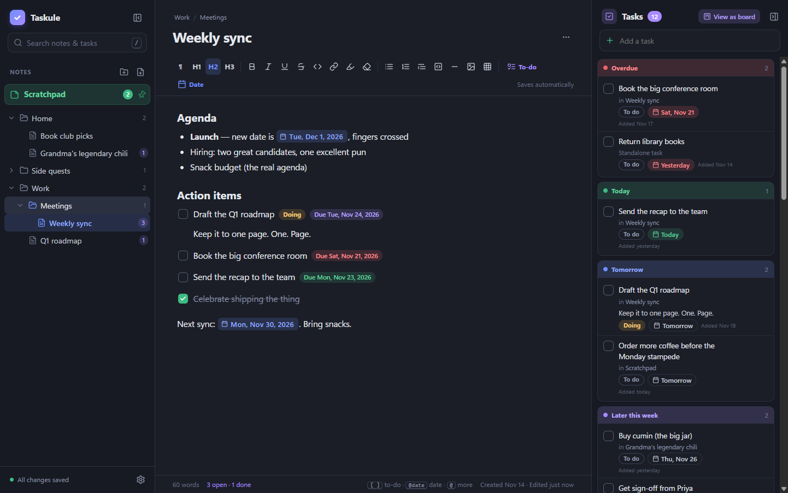
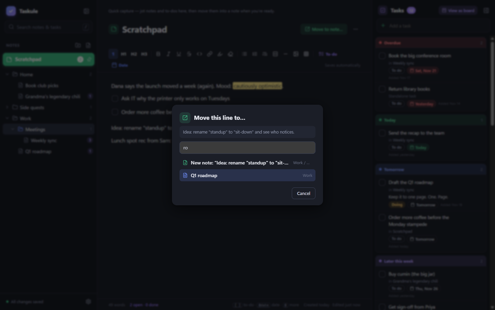
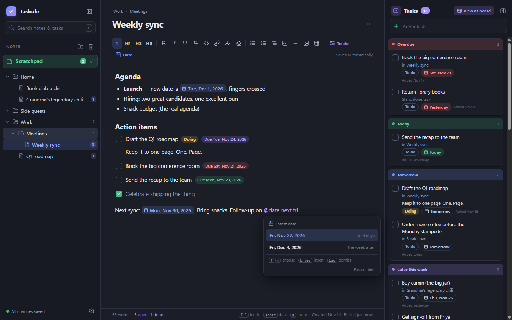
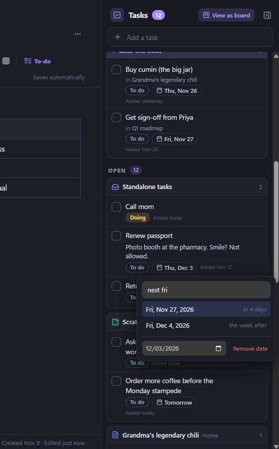
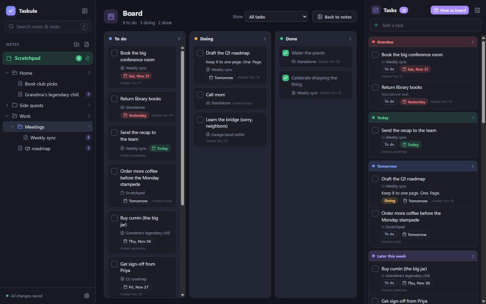
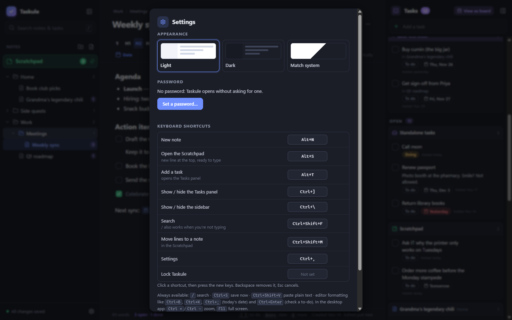
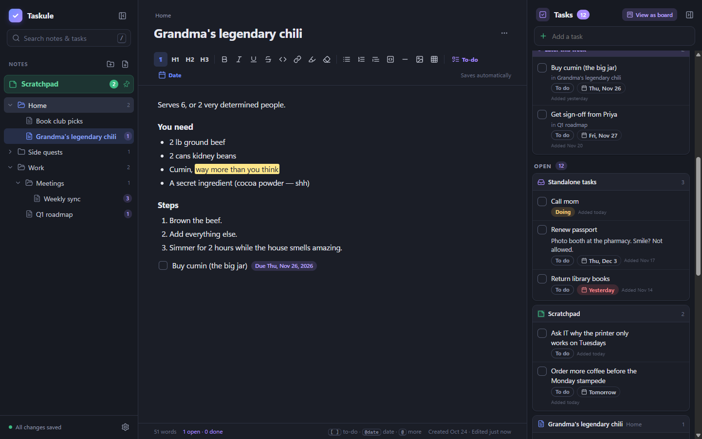
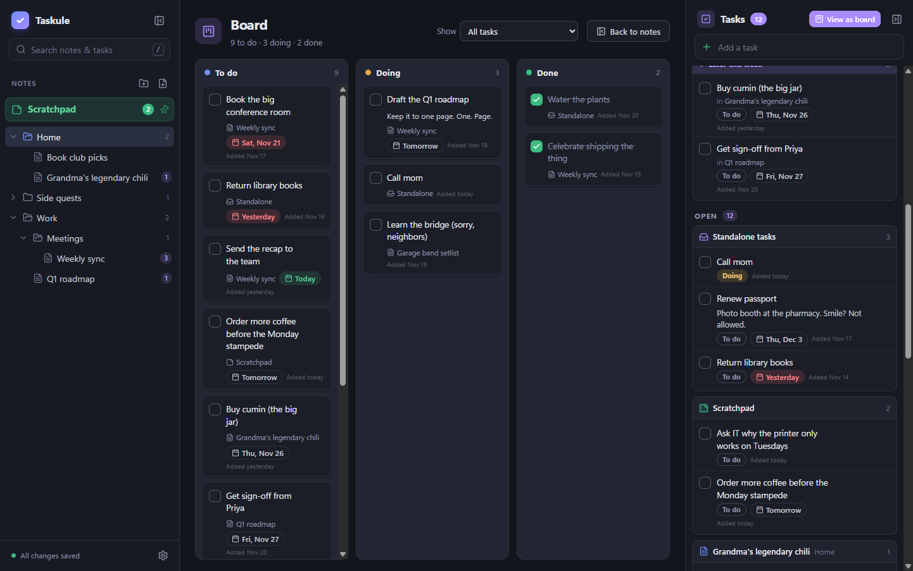

# ✅ Taskule

**Notes and to-dos that live on your computer, load instantly, and never lose a word.**

Taskule is a small, cozy notes app with a to-do list sitting next to it. You write notes, sprinkle to-dos into them, and every task ends up in one tidy panel sorted by when it's due. There's no cloud, no account and no subscription, and nobody else is invited. It's just you, your notes and a little SQLite file.



> *All screenshots use made-up sample data. Grandma's chili recipe is, sadly, also made up.*

**The highlights:**

- 📝 **The Scratchpad**: one always-there note for "I'll sort this out later." Taskule opens on it.
- ⚡ **Alt + Win + Space** from *anywhere* in Windows drops you onto a fresh line in the Scratchpad.
- ✅ **To-dos inside your notes** (`[ ] `) that show up in a Tasks panel, grouped into **Overdue / Today / Tomorrow / Later this week**.
- 🗂️ **A kanban board**: drag tasks between **To do**, **Doing** and **Done**.
- 📅 **Dates in plain English**: type `@date next fri` and it just knows.
- 🧲 **Drag-and-drop sidebar** with folders in whatever order you like, plus panels you can resize.
- 🌙 **Dark mode**, adjustable keyboard shortcuts, and an optional password.
- 📋 **Paste from Google Docs** with formatting, checklists, images and even dates intact.
- 💾 **Paranoid about your data**: verified automatic backups, crash-safe saves, and exports to Word, PDF and Markdown.

---

**Jump to:** [Getting started](#-getting-started) · [The tour](#-the-tour) · [Shortcuts](#-shortcuts) · [Downloads & backups](#-downloads-backups--restoring) · [Reliability](#-reliability-and-data-safety) · [Development](#-development)

---

## 🚀 Getting started

### The desktop app (Windows)

Open **Taskule** from the Start menu or the Desktop shortcut and you're in. It runs in its own window, and also:

- **Starts with Windows**, quietly, in the system tray. That's what keeps the quick-capture hotkey always ready. Don't want it? Untick **Start with Windows** in the tray menu.
- **The X button hides it to the tray** rather than quitting. Taskule keeps running, so it's there the moment you need it. Click the tray icon (or any Taskule shortcut) to bring it back. Right-click the tray icon for **Open**, **Quick capture to Scratchpad**, **Lock**, **Start with Windows** and **Quit Taskule**. Quitting saves everything first, and asks if it can't. Minimize works as usual.
- **Pin it to the taskbar:** open Taskule, right-click its taskbar button and choose **Pin to taskbar**. The pin and the window behave as one button.
- **Desktop niceties:** right-click gives Cut/Copy/Paste and spelling suggestions. `Ctrl +` / `Ctrl -` / `Ctrl 0` zoom, `F11` goes full screen, links open in your normal browser, and downloads ask where to save (starting in Downloads).
- **The server takes care of itself.** If a Taskule server is already running (for example from [auto-start](#start-the-server-automatically-with-windows)), the app uses it. Otherwise the app starts its own and stops it when you quit. It checks every few seconds that a server is answering and starts one if not. Either way, your notes live in this folder's `data/`.

#### Building the app

The app is built into `dist\Taskule-win32-x64\Taskule.exe` (Electron). After changing any code, quit the app (tray icon → **Quit Taskule**) and rebuild. The folder is updated in place, so your taskbar pin survives:

```bash
npm run app:build
```

This also (re)creates the Start menu and Desktop shortcuts (add `-- --no-shortcuts` to skip that). `npm run app` runs it straight from source without building.

### In a browser

You need **Node.js 22.13+** (Taskule uses Node's built-in SQLite). There's nothing to install:

```bash
npm start
```

Then open **http://localhost:4747**.

- Different port: `PORT=5000 npm start` (PowerShell: `$env:PORT=5000; npm start`).
- The server only listens on `127.0.0.1`, so nothing else on your network can reach it.
- Your data lives in `data/taskule.db` (SQLite) and `data/images/`, with automatic backups in `data/backups/`. `data/` is never committed.

#### Start the server automatically with Windows

```bash
npm run autostart:on
```

This adds a **Taskule server** shortcut to your Windows **Startup** folder. It runs the server hidden every time you log in, starts it right away, and restarts it if it ever stops unexpectedly. Output goes to `data/server.log`. The shortcut runs `wscript.exe` directly, so it works even if `.vbs` files are set to open in an editor.

| Command | What it does |
| --- | --- |
| `npm run autostart:status` | Shows whether auto-start is on and whether the server is running |
| `npm run autostart:off` | Removes auto-start (a running server keeps running) |
| `npm run stop` | Stops the server and the auto-start loop that would restart it (e.g. before restoring a backup) |
| `npm run autostart:on` | Turns it back on, and starts the server if it isn't running |

After changing `server.js`, restart with `npm run stop` and then `npm run autostart:on`. Changes in `public/` only need a browser refresh.

---

## 🎡 The tour

### 📝 The Scratchpad: your brain's junk drawer

The **Scratchpad** is the green row pinned to the top of your notes. It's one permanent note for jotting things down *right now* (in a meeting, mid-thought, mid-sandwich) and sorting them out later. It can't be moved, renamed or deleted, and **Taskule always opens on it**.

- `Alt+S` jumps there with a **new empty line at the top**, cursor blinking, ready to type.
- To-dos work as usual (`[ ] `) and show up near the top of the Tasks panel. The green badge counts the open ones.
- **⋯ → Clear Scratchpad** wipes it clean. You can undo it, in case you get carried away.

**Move to note…** (`Ctrl+Shift+M`, or the button at the top) is the "sorting it out later" part. Select some lines, or just leave the cursor on one, and send them to the end of another note:



Pick a note (most recently edited first; type to filter), or choose **New note**. A new note takes its title from the first line and is created in the selected folder. Moved to-dos join a to-do list at the end of the note. Changed your mind? **Undo** is right there in the toast.

### ⚡ Quick capture from anywhere: Alt + Win + Space

In **any** program, press **Alt + Win + Space**. Taskule jumps forward with a fresh line at the top of the Scratchpad and the cursor on it. Type your thought, then get back to what you were doing. If Taskule is locked, you unlock first and then land there.

It works whenever the desktop app is running, even hidden in the tray, which is why the app starts with Windows. (Why not Ctrl + Win + Space? Windows keeps that one for switching keyboard languages and won't share.)

### 🗂️ Notes, folders and making it yours

Notes live in nested folders in the left sidebar.

- The `+` buttons make a new note or folder inside the selected folder. Click **NOTES** to select the top level.
- **Arrange things however you like.** Drag a note or folder onto the top or bottom edge of another to drop it before or after (a blue line shows where). Drop it on the middle of a folder to put it inside. Not a dragger? Right-click → **Move up** / **Move down** (or `Alt+↑` / `Alt+↓` on a selected row), or **Move to…** another folder.
  - Folders stay above notes at each level. Anything you haven't arranged is listed alphabetically after the things you have.
  - Reordering doesn't count as editing a note. The Tasks panel and downloads follow your order too.
- Double-click a folder (or press `F2`) to rename it.

**Make room.** Drag the inner edge of the sidebar or the Tasks panel to resize it (a blue line appears when you hover the edge). Double-click the edge to reset it, or select it and use the arrow keys. Widths are remembered, and the page in the middle always keeps enough room.

**Hide the panels.** The panel button at the top of the sidebar (or `Ctrl+\`) tucks it away so your note gets the whole window. While it's hidden, nudge the mouse to the left edge and it slides back out. It stays while you're using it and slides away when you click back into the page. Click the **pin** (or press `Ctrl+\` again) to keep it open. The Tasks panel works the same way (`Ctrl+]`); while it is hidden, a small button at the top right shows how many tasks are open. Taskule remembers your choice.

### ✍️ The editor

It's a normal "what you see is what you get" editor: headings, **bold**, *italic*, underline, strikethrough, `code`, links, lists, quotes, code blocks, dividers, **highlights**, **tables**, **images** and to-dos. Markdown habits work as you type: `# ` makes a heading, `- ` a bullet, `1. ` a numbered list, `[ ] ` a to-do, `**bold**` bold and `> ` a quote. Clear formatting is a toolbar button away. Click the table button inside a table for row and column options.

**The @ menu:** type `@` to insert things: Date, To-do, Image, Table, Link, Heading 1–3, lists, Quote, Code block or Divider. Keep typing to filter (`@ta` → Table) and press Enter to pick. Anything that isn't a command (like `@dana`) stays plain text, so you can still @ people in your notes.

**Images:** paste them, drag image files in, or use the toolbar button or `@image`. Click an image and drag a corner to resize it (proportions are kept). Images are saved in `data/images/`. Pictures pasted from Google Docs or web pages are downloaded too, so your notes never depend on a link that might expire.

### 📅 Dates in plain English

Type `@date` and then whatever you'd say out loud. A picker shows the exact date before you commit to it:



| You type | You get (if today is Fri, Nov 13) |
| --- | --- |
| `@date`, `@date today` | Fri, Nov 13 |
| `@date tomorrow`, `@date yesterday` | Sat, Nov 14 / Thu, Nov 12 |
| `@date last thursday` | Thu, Nov 12 (the most recent one before today) |
| `@date thursday`, `@date this thu` | Thu, Nov 19 (the next one; today counts) |
| `@date next friday` | Fri, Nov 20, or pick Nov 27 ("the week after") |
| `@date thursday next week` | Thu, Nov 19 |
| `@date in 3 days`, `@date 2 weeks from now`, `@date 3 days ago`, `@date +5` | relative dates |
| `@date next week`, `@date next month`, `@date end of month`, `@date this weekend` | exactly what they sound like |
| `@date nov 20`, `@date 20th of november`, `@date 11/20`, `@date 2026-12-01` | absolute dates (the nearest year if you leave it out) |

- `Ctrl+;` drops in today's date instantly, and the **Date** toolbar button opens the picker.
- "Today" always means today in **US Eastern time** (daylight saving included), whatever your computer's clock says.
- `Esc` closes the picker and keeps what you typed.
- In open to-dos, overdue dates turn **red** and today's turn **green**, both in the note and in the Tasks panel. `@date` works in the **Add a task** box too.

### ✅ The Tasks panel: everything you promised to do, in one place

The panel on the right gathers **every** task:

- **Standalone tasks:** type into **Add a task** at the top. `Alt+T` opens the panel with the cursor already there.
- **Note to-dos:** start any line in any note with `[ ] ` (or click **To-do** in the toolbar). They're grouped by note in the panel, in your sidebar order.



- **Due soon floats to the top.** Open tasks with an upcoming due date gather under **Overdue**, **Today**, **Tomorrow** and **Later this week** (through Sunday), each showing which note it came from. Empty groups stay out of the way. These tasks also stay in their normal group below.
- **Edit right in the panel.** Click a title to change it (Enter saves, Esc cancels). Hover a task for:
  - **Details:** free text under the title (the lines icon).
  - **Due date:** the calendar. Type plain English ("tomorrow", "next fri", "12/1"), pick a suggestion, or use the calendar. Overdue is red, today is green.
- **For note to-dos**, the details are the lines written under the to-do in the note, and the due date is a badge at the end of the line (click it to change it). Details with fancy formatting (a table, a code block…) are edited in the note.
- **"Added …" dates.** Every task shows a small, faint date underneath for when it was created. That's separate from when it's *due*. Hover it for the exact time and when it was last changed. To-dos written before this feature existed have no recorded date, so they show none. A note's footer shows when the note was created and last edited.
- **Columns:** each open task wears a little chip showing its column, **To do** or **Doing**. Click the chip to move it. In a note, a to-do that's in progress gets a **Doing** badge.
- **Check it off** anywhere (the panel, the board, the note, or `Ctrl+Enter` in the editor) and it moves to **Completed** at the bottom, below a darker divider, still grouped the same way. Deleted something by accident? Undo is in the toast.

<br clear="right">

### 🗂️ The board: To do → Doing → Done

Click **View as board** at the top of the Tasks panel and your tasks spread out into three columns across the main area:



- **Drag a card** to another column, or use its **⋯** menu (move it, open its note, delete it).
- Edit titles right on the card, click a due date to change it, and tick a card to send it to **Done**.
- **Show** picks all tasks, just standalone tasks, or one note's tasks.
- Open cards are sorted by due date, and **Done** shows the most recently finished first.
- **Done** and "checked" mean the same thing. Checking a task moves it to Done, and unchecking it sends it back to the column it was in.
- **Back to notes** (or the button again) takes you back to your notes. The column is saved with the task, so the list and the board always agree.

### 🔍 Search

Press `/` (or `Ctrl+Shift+F`) to search note titles, note text, dates, tasks and folder names all at once. Clicking a note result opens it with the match selected.

### 📋 Moving in from Google Docs

Copy in Docs, paste into a note. That's it. Taskule keeps:

- headings, bold, italic, underline, strikethrough and links (Google's redirect links are unwrapped to the real URL)
- bulleted and numbered lists, including nested ones
- Google Docs checklists, which become to-dos (ticked items stay ticked, and they show up in the Tasks panel)
- tables, highlights and coloured text
- images (saved locally)
- written dates with a year (`Mar 6, 2026`, `March 6th 2026`, `06/10/2025` as month/day/year, `2026-03-06`), which become date tags. Dates without a year stay as text.

Fonts, font sizes, line spacing, black/grey text colours and table cell shading are dropped on purpose, so everything looks consistent.

Pasted a note before date tagging existed? Open it and choose **⋯ → Tag dates in this note** (undoable).

Other ways in:
- **Copy as Markdown** in Google Docs (right-click → *Copy as Markdown*; turn it on under *Tools → Preferences → Enable Markdown*) also pastes fully formatted, tables and checkboxes included. Any Markdown pasted as plain text is converted.
- Lines starting with ☐ / ☑ become to-dos.
- `Ctrl+Shift+V` pastes as plain text, no formatting.

### ⚙️ Settings, dark mode and the gear menu

The **gear** at the bottom of the sidebar keeps the grown-up stuff in one place: **Settings…**, **Download a copy…**, **Lock now** (once you've set a password) and **Wipe database…**.



**Settings** (gear → Settings…, or `Ctrl+,`):

- **Appearance:** Light, Dark, or Match system (it follows Windows as it switches).
- **Password:** Taskule has none by default and opens straight away. If you want one, choose **Set a password…** here. You can change or remove it later in the same spot (both ask for the current password).
- **Keyboard shortcuts:** click one and press new keys. Backspace removes it and Esc cancels. Keys the editor or window already use (like `Ctrl+B` or `F11`) can't be taken, and plain letters need `Ctrl` or `Alt`. If you grab keys another action uses, they move over and Taskule tells you which action lost them. **Reset** puts one back; **Reset all shortcuts** puts them all back.
- Settings are kept per device: the desktop app and each browser remember their own.

And yes, dark mode is properly dark:



<details>
<summary>🌙 The board in dark mode, too</summary>



</details>

### 🔒 The optional password

- Once a password is set, Taskule asks for it each time you open the app or the browser. **Lock now** in the gear menu saves everything and locks immediately. The lock is enforced by the server, so it covers the browser at http://localhost:4747 too.
- It's stored hashed (scrypt) in `data/password.json`, which is never committed. Changing it locks out anyone else who's currently unlocked.
- From the command line: `npm run set-password -- "new password"`, or `npm run set-password -- --none` to remove it.
- Forgot it? Delete `data/password.json` and Taskule opens without one.
- If the lock appears mid-edit (the password changed, or a session turned 30 days old), whatever you were saving waits behind the lock screen and is sent once you unlock. Nothing is dropped.

---

## 🎹 Shortcuts

The first group can be changed in **Settings**; these are the defaults.

| Key | Action |
| --- | --- |
| `Alt+N` | New note |
| `Alt+T` | Open the Tasks panel and start a new task |
| `Ctrl+]` | Show / hide the Tasks panel |
| `Ctrl+,` | Settings |
| `Alt+S` | Scratchpad (new line at the top, ready to type) |
| `Ctrl+Shift+M` | In the Scratchpad: move selected lines to a note |
| `Ctrl+\` | Show / hide the sidebar |
| — | Lock (no key unless you set one) |
| `Ctrl+Shift+F` | Search |
| **Always available** | |
| `Alt+Win+Space` | Desktop app, from anywhere in Windows: quick capture to the Scratchpad |
| `/` | Search (when you're not typing) |
| `@` | Insert menu (date, image, table, …) |
| `@date` … | Insert a date |
| `Ctrl+;` | Insert today's date |
| `Ctrl+Enter` | Check/uncheck the to-do at the cursor (or turn the line into a to-do) |
| `Ctrl+B` / `Ctrl+I` / `Ctrl+U` | Bold / italic / underline |
| `Ctrl+Shift+S` | Strikethrough |
| `Ctrl+Shift+H` | Highlight |
| `Ctrl+Shift+V` | Paste as plain text |
| `Ctrl+E` | Inline code |
| `Ctrl+K` | Link (Ctrl+click a link to open it) |
| `Ctrl+Alt+1/2/3` | Heading 1/2/3 |
| `Ctrl+Shift+7/8/9` | Numbered / bulleted / to-do list |
| `Tab` / `Shift+Tab` | Indent / outdent a list item |

---

## 💾 Downloads, backups & restoring

**Download a copy** (gear → Download a copy…) saves everything. Pick a flavour:

| Option | You get |
| --- | --- |
| **Word document (.docx)** | One formatted document: a To-dos summary (open and completed, grouped by note, with due dates and details), then every note grouped by folder, with headings, lists, checkboxes, tables, images, links, highlights and colours. Opens in Word, Google Docs or Pages. |
| **Markdown (.zip)** | One `.md` file per note in your folder structure, an `images/` folder, and `To-dos.md`. |
| **PDF (.pdf)** | A print-ready copy of the same content as the Word export, with page numbers. |
| **Database backup (.zip)** | An exact snapshot of `taskule.db` plus all images and a `RESTORE.txt`. Safe to take while the app is running. |

**Wipe database** (gear → Wipe database…) deletes everything once you type `delete`. A safety backup is always made first (no backup, no wipe), and image files are kept for 30 days so that backup can be restored with its pictures.

### Backups and restoring

Taskule backs itself up automatically to `data/backups/`: when the server starts (if the newest backup is more than 12 hours old), once a day while it runs, and right before any wipe. Each backup is checked after it's written, and the newest 20 are kept. The Download dialog shows when the last one ran, and you're alerted if a backup ever fails. **Download → Database backup** gives you a zip to keep somewhere else.

To restore:
1. Quit the app (tray icon → **Quit Taskule**) and run `npm run stop`.
2. Rename `data/taskule.db` to `taskule-damaged.db` (keep it), and delete `taskule.db-wal` / `taskule.db-shm` if they're there.
3. Copy the backup you want (e.g. `data/backups/taskule-2026-11-20-090000-auto.db`, or `taskule.db` from a downloaded zip) to `data/taskule.db`. If it came from a zip, also copy its `images/` into `data/images/`.
4. Start Taskule again.

---

## 🦺 Reliability and data safety

Taskule is easygoing about most things, but not about your data.

**You can't type into a void.** The app checks the server every few seconds, and right away whenever a save fails. If the server can't be reached, saves keep failing, or the database reports a problem, the window is covered with a message explaining what's wrong, and editing pauses until it's fixed. When the server comes back, the cover lifts by itself and everything waiting is saved. The desktop app also restarts a missing server on its own.

- **Nothing typed is lost.** Every note edit is kept on this computer until the server confirms it's saved. If the app or browser closes while the server is down, those edits are restored (with a notice) the next time you open Taskule.
- **Problems are never quiet.** A refused save, a conflict or a failed backup shows a message that stays until you close it.
- **Two windows can't overwrite each other.** Each note has a version number. If a note changed in another window or tab since this one loaded it, the save is refused rather than overwriting. Both texts are kept: the other version stays, and this window's edits are saved as a "(my copy …)" note next to it.
- **The database is protected.** SQLite runs in WAL mode with `synchronous=FULL`, so a change is on disk before it's reported as saved, and it survives a crash or a power cut. Every write is a transaction, note content is checked to be a valid document before it's stored, and all writes are idempotent, so retries can't duplicate anything.
- **Damage is caught, not spread.** The database's structure is checked at startup and every 6 hours. If a check fails, the server refuses all changes so a damaged file isn't made worse, the app shows "Your database needs attention", and no automatic backup is taken from it, so it can't push out the good ones. Restore from `data/backups/` ([above](#backups-and-restoring)).
- **Automatic, verified backups** run daily, at startup and before a wipe.
- **Images are never deleted early.** An image file is only removed after no note has used it for 30 days, so undo and restored backups still find their pictures.
- **The server keeps running.** An unexpected error in one request is logged to `data/server.log` and the server carries on. The auto-start launcher restarts the server if it stops.
- Note edits are sent about 0.4 s after you stop typing, and immediately on blur, navigation, tab switch or close.
- The API rejects cross-origin requests, so other websites open in your browser can't touch your data.
- **Earlier names.** Taskule used to be called Jotcairn, and before that Actionbase. The first time the server starts after a rename, `data/jotcairn.db` (or `data/actionbase.db`) becomes `data/taskule.db`: pending writes are folded in first, and the file is renamed rather than copied. Older `jotcairn-*.db` and `actionbase-*.db` backups still count as backups. Browser-stored settings and unsaved-edit backups carry over, and the desktop app copies its settings from the old profile.
- Notes written with the earlier markdown editor are converted to rich text automatically the first time the app loads.

---

## 🔧 Development

The editor ([TipTap](https://tiptap.dev)) and the exporters ([docx](https://docx.js.org), [pdfmake](https://pdfmake.github.io), [fflate](https://github.com/101arrowz/fflate)) are pre-bundled into `public/vendor/`, so running the app needs no `npm install`. To change them:

```bash
npm install
npm run build
```

`npm test` runs three sets of tests against throwaway servers:
- the date-parser tests
- the to-do helper tests (details, due dates, columns, editing)
- the server tests: task details, due dates and columns; sidebar order; renaming a database from the app's earlier names; the optional password; Scratchpad rules; content validation; version conflicts; backups; wipe safety; and a damaged database or password file

Paste handling lives in `editor/src/paste.js`, and `test/fixtures/gdocs-paste.html` is a sample Google Docs clipboard payload for checking it.

The README screenshots live in `docs/screenshots/` and show sample data only.
